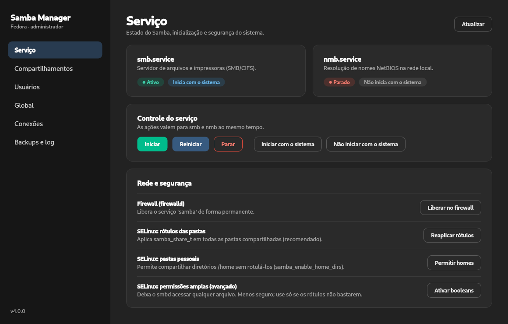

# Samba Manager

Gerenciador gráfico de compartilhamentos Samba (SMB/CIFS) para Fedora, escrito
em C++20 com Qt 6.



## Recursos

- **Serviço** — estado de `smb`/`nmb`, iniciar/parar/reiniciar, inicialização
  com o sistema, liberação no firewalld e ajustes de SELinux.
- **Compartilhamentos** — criar, editar e remover, com validação pelo
  `testparm` antes de gravar. A pasta é criada com o seu usuário como dono
  (modo 2775) e recebe o rótulo `samba_share_t`.
- **Usuários** — contas Samba (criar, senha, habilitar/desabilitar, remover).
- **Global** — workgroup, descrição e nome NetBIOS.
- **Conexões** — saída do `smbstatus`.
- **Backups e log** — as últimas 10 versões de cada arquivo alterado
  (`smb.conf`, `passdb.tdb`, …), comparação com o atual, restauração e um
  histórico legível das mudanças.

O parser do `smb.conf` preserva comentários, formatação, linhas `include`
repetidas e linhas continuadas: só as linhas que mudam são reescritas.

## Segurança

A interface roda como **usuário comum**. As operações administrativas ficam
num auxiliar separado (`samba-manager-ng-helper`, só QtCore), aberto uma única
vez via `pkexec`, que conversa com a interface por JSON em stdin/stdout e só
aceita uma lista fechada de operações, cada uma validando os próprios
argumentos — não existe operação genérica de "rodar comando" ou "gravar
arquivo". Gravações são atômicas, e o SELinux recusa rotular áreas do sistema,
pastas pessoais inteiras e diretórios como `.ssh`.

## Instalação (AppImage)

Baixe o AppImage em [Releases](../../releases), dê permissão de execução e
abra. Ele usa o Qt 6 do sistema:

```sh
sudo dnf install qt6-qtbase-gui qt6-qtwayland samba samba-client polkit \
                 policycoreutils-python-utils
chmod +x Samba-Manager-NG-*-x86_64.AppImage
./Samba-Manager-NG-*-x86_64.AppImage
```

## Compilação

Local (Fedora):

```sh
sudo dnf install gcc-c++ cmake ninja-build qt6-qtbase-devel samba-common-tools
cmake -S . -B build -G Ninja
cmake --build build
ctest --test-dir build --output-on-failure   # testes (UI em modo offscreen)
./build/samba-manager-ng
```

Em um servidor com podman (contêiner Fedora 44, binários trazidos para
`out/`) e geração do AppImage:

```sh
SM_BUILD_HOST=usuario@servidor tools/build-remote.sh    # [--sanitize] [--no-tests]
SM_BUILD_HOST=usuario@servidor tools/build-appimage.sh  # [--no-build]
```

## Licença

[GPL-3.0-or-later](LICENSE): use, estude, altere e redistribua à vontade.
Versões modificadas que forem distribuídas precisam continuar livres, com o
código-fonte aberto e sob a mesma licença.
